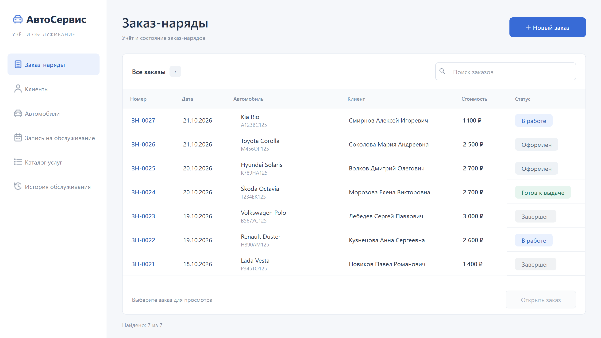

# АвтоСервис

Настольное приложение для мастера-приёмщика автосервиса: клиенты, автомобили, запись на обслуживание и заказ-наряды с сохранением данных в SQLite.



## Возможности

- Клиенты и автомобили со связью по ID, поиском, редактированием и защитой связанных записей от удаления.
- Каталог услуг с категориями, длительностью и ценами в целых рублях.
- Предварительная запись с получасовыми интервалами и защитой от конфликтов; отменённые посещения сохраняются для просмотра.
- Создание и редактирование активных заказов, автоматический пересчёт суммы и последовательные статусы: «Оформлен → В работе → Готов к выдаче → Завершён».
- Исторические цены и сведения документов; завершённые заказы доступны только для просмотра и появляются в истории обслуживания.
- Постоянная светлая тема Fusion, компактные списки с прокруткой и светлый календарь. Основной размер окна — 1280×720, проверяются масштабы Qt 100–150%.

Другие экраны: [клиенты](screenshots/current_clients.png), [автомобили](screenshots/current_car.png), [запись](screenshots/current_calendar.png), [услуги](screenshots/current_services.png), [история](screenshots/current_history.png), [редактирование заказа](screenshots/stage92_edit_order.png). Все изображения содержат вымышленные данные. [Каталог снимков](screenshots/README.md) также сохраняет изображения для ранее подготовленных отчётов.

## Установка и запуск

Технологии: Python, PySide6/Qt Widgets, SQLite из стандартной библиотеки. Проверенная среда — **Windows x64, Python 3.12**, PySide6 6.12.0. Для исходников нужен Python 3.10+ с поддерживаемым колесом PySide6; зависимости закреплены в requirements-файлах. Запускайте команды из корня репозитория:

```powershell
py -3.12 -m venv .venv
.\.venv\Scripts\python.exe -m pip install -r requirements.txt
.\.venv\Scripts\python.exe main.py
```

Первый обычный запуск создаёт **пустую** базу `%LOCALAPPDATA%\AutoService\autoservice.db`. Клиентов, автомобили и услуги пользователь добавляет самостоятельно. Данные сохраняются между запусками; путь базы не зависит от текущего каталога и расположения программы. При ошибке доступа или открытия программа показывает сообщение и не подменяет данные демонстрацией.

Демонстрационный режим работает только в памяти и не открывает рабочую базу:

```powershell
.\.venv\Scripts\python.exe main.py --demo
```

Изменения демонстрационных данных исчезают после закрытия. Снимки тоже используют демонстрационные данные; имя PNG без каталога направляется в `screenshots/`:

```powershell
.\.venv\Scripts\python.exe main.py --screenshot screenshots/orders.png
.\.venv\Scripts\python.exe main.py --screenshot screenshots/add_service.png --screen services --dialog
.\.venv\Scripts\python.exe main.py --screenshot screenshots/completed_order.png --order-card 23
```

`--screen` принимает `orders`, `clients`, `car`, `calendar`, `services`, `history`. `--dialog` и `--order-card` используются только с `--screenshot`; у истории нет формы создания.

## Структура

```text
main.py                   CLI, QApplication, тема и жизненный цикл SQLite
autoservice/
  app.py                  главное окно, навигация, клиенты и автомобили
  dialogs.py              формы клиентов и автомобилей
  data.py                 бизнес-правила, нормализация, время UTC+10
  demo_data.py            демонстрационные наборы и генераторы
  database.py             SQLite API, схема v2, миграция и backup
  persistence.py          транзакционное обновление коллекций интерфейса
  orders.py               заказ-наряды, формы и карточка документа
  appointments.py         запись на обслуживание
  services.py             каталог услуг
  history.py              история из общей коллекции заказов
  styles.py, ui.py         QSS и общие виджеты
tests/                   модульные и интеграционные проверки Qt/SQLite
screenshots/             документационные PNG
AutoService.spec          конфигурация PyInstaller
build.ps1                сборка папки приложения и ZIP
requirements*.txt        зависимости запуска и сборки
```

## Сохранность данных

Запись выполняется в транзакциях с поддержкой SAVEPOINT. Перед COMMIT проверяется соответствие суммы, количества и фактических позиций заказов. Многошаговое чтение документа использует согласованный снимок без резервирования SQLite writer. Интерфейс публикует изменения только после успешного сохранения; ошибка записи оставляет данные формы доступными для повторной попытки.

Снимки названий и цен оставшихся работ не меняются при правке каталога, даже если услуга удалена. Новые работы получают актуальную цену при сохранении; удалённая и добавленная повторно работа может получить новую цену. ID, дата и статус заказа при редактировании сохраняются. Завершённые документы защищены API и SQL-триггерами; устаревшая форма не может перезаписать заказ, завершённый другим соединением.

Существующие базы версии 1 автоматически мигрируют в **версию 2** без пересоздания таблиц. Перед изменением схемы создаётся проверенная копия штатным SQLite online backup в соседней папке `backups/`, включая сведения из WAL. Имена уникальны, прежние копии не перезаписываются. Невозможность создать копию останавливает миграцию; ошибка самой миграции откатывает изменения, сохраняя копию для восстановления. Новая пустая база и повторное открытие v2 резервных копий миграции не создают.

Не удаляйте базу для исправления ошибки запуска. Для ручного копирования или восстановления сначала закройте приложение. Папка EXE и пользовательские данные хранятся отдельно; при переносе программы сохраните базу и резервные копии отдельно.

## Тесты

```powershell
# Целевые проверки хранения и редактирования
.\.venv\Scripts\python.exe -m unittest -v tests.test_storage_safety tests.test_order_editing
# Полная регрессия
.\.venv\Scripts\python.exe -m unittest discover -v
```

Тесты используют временные базы внутри `.tmp/`, отдельные процессы с временным LOCALAPPDATA и реальные Qt-формы на Windows. Проверяются CRUD, связи, валидация, транзакции и отказы COMMIT, миграция/backup/повторный запуск, конкурентные соединения, исторические цены, все разделы, CLI, тема, клавиатура и масштабы. Полный сценарий включает создание клиента, машины, услуги, посещения и заказа, редактирование, завершение и повторный запуск с восстановлением истории.

Тестовые PNG сохраняются **только в `.tmp/test-screenshots/`**; отслеживаемые изображения в `screenshots/` не перезаписываются. Системная тема и масштаб Windows при автоматических проверках не переключаются: проверяются палитры и коэффициенты Qt.

## Windows EXE

Установите зависимости сборки и запустите подготовленный скрипт:

```powershell
.\.venv\Scripts\python.exe -m pip install -r requirements-build.txt
powershell -ExecutionPolicy Bypass -File .\build.ps1
```

Скрипт проверяет разрядность Python и зависимости, использует `AutoService.spec`, создаёт `dist\AutoService\AutoService.exe` с папкой `_internal`, добавляет инструкцию и формирует `release\AutoService-Windows-x64.zip`. Папки `build/`, `dist/`, `release/`, базы, backup, кэш и временные файлы исключены из Git.

Для пользователя: распаковать архив **целиком** и запустить `AutoService.exe`; установленный Python не нужен. Не отделяйте EXE от `_internal`. Демонстрация доступна через `AutoService.exe --demo`. Подробнее — [README-Windows.txt](README-Windows.txt).

Конфигурация проверяется без сборки: пути, импорты, зависимости, Qt-компоненты и PowerShell-синтаксис. Готовый EXE после рефакторинга ещё не собран и не проверен.
