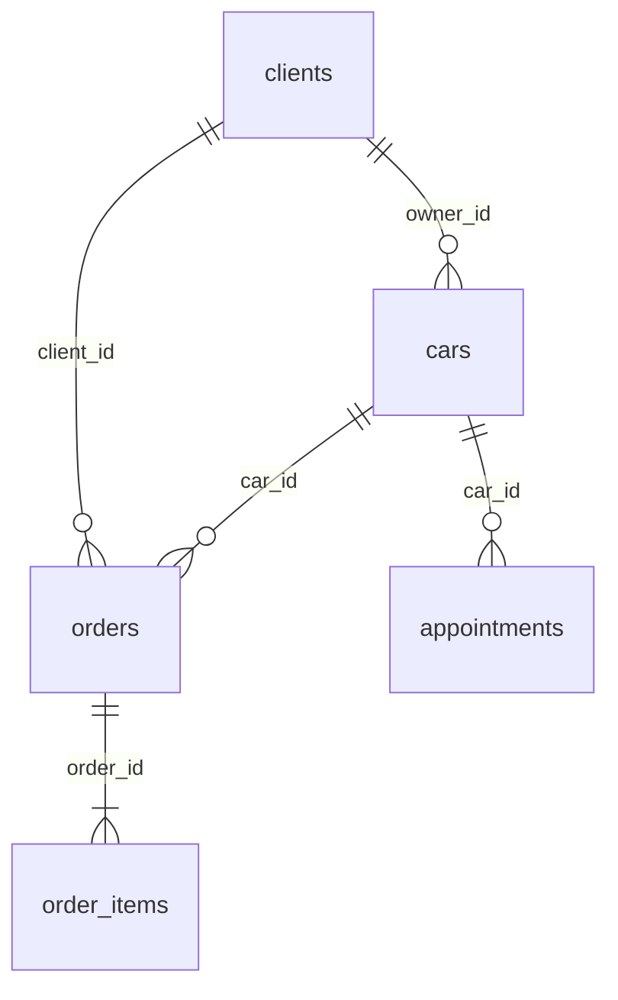

# АвтоСервис — графический прототип

На этапе **8.2** существующие экраны «Клиенты», «Автомобили» и «Каталог услуг» подключены к SQLite через необязательную зависимость `MainWindow(database=db)`; отдельно поддерживается `ServicesPage(database=db)`. В этом режиме ID назначает БД, изменения сохраняются на диск, таблицы обновляются только после успешного COMMIT. Оформление, поиск и проверки форм сохранены.

**Обычный запуск пока остаётся демонстрационным:** `MainWindow()` использует прежние коллекции в памяти (семь клиентов, девять автомобилей, девять услуг, семь записей и семь заказов). При перезапуске они восстанавливаются. Это сохраняет совместимость прежних тестов и скриншотов до подключения заказов и расписания. Настройки режима и автоматическое заполнение SQLite не добавлены. Подробности слоя хранения приведены в разделе «SQLite: этап 8.1».

## Подключение справочников: этап 8.2

Переданный `Database` принадлежит вызывающему коду: он создаёт и закрывает соединение после завершения работы окна. Пример внедрения (при уже созданном `QApplication`):

```python
from autoservice.database import Database
from main import MainWindow

with Database(path_to_database) as db:
    window = MainWindow(database=db)
    window.show()
    app.exec()
```

При таком запуске клиенты, автомобили и услуги читаются из указанной БД; пустая база даёт пустые справочники. Заказы, предварительные записи и история начинают с пустых коллекций: демонстрационные документы с посторонними ID не подмешиваются. Новые документы этих экранов пока существуют только в памяти и исчезают при закрытии; уже сохранённые API заказы и записи на этих экранах ещё не отображаются. Обычный демонстрационный запуск остаётся прежним.

Общий небольшой помощник `autoservice/persistence.py` выполняет операцию и повторное чтение затронутых справочников в одной транзакции. После COMMIT обновляет списки на месте, сохраняя ссылки зависимых экранов; затем обновляются таблицы. При отказе записи, чтения или COMMIT транзакция откатывается, прежние строки, поиск и выделение сохраняются, показывается сообщение с подробностями SQLite. Списки служат снимками БД для интерфейса, отдельного постоянного хранилища нет.

Количество автомобилей вычисляется по связанным записям `owner_id`, после добавления, удаления и смены владельца обновляются оба счётчика. Переименование клиента обновляет ФИО владельца. Связанные объекты защищены как существующими проверками интерфейса для документов в памяти, так и внешними ключами SQLite для сохранённых документов. Цены услуг остаются целыми рублями, исторические позиции заказов не меняются при изменении или удалении услуги. Пользователь видит `КЛ-0001`, `АВ-0001`, `УС-0001`, связи используют числовые ID.

Проверки интеграции запускаются отдельно:

```powershell
.\.venv\Scripts\python.exe -m unittest -v tests.test_reference_sqlite
```

Исходные **53 теста** прошли до изменений. После подключения прошли **67 тестов: 53 прежних без ослабления + 14 новых интеграционных**. Новые проверки используют отдельные временные БД в `.tmp/reference-test-*/` и реальные Qt-формы; соединения закрываются, файлы удаляются. Проверены создание/редактирование/удаление, поиск, сохранение клиентов, автомобилей и цены услуги после повторного открытия БД, смена владельца и счётчики, запреты удаления по связям, ID, исторические цены, уникальность при устаревшем снимке интерфейса, SQL-ошибки и блокировка другим соединением, откат при ошибке повторного чтения. Проверено отображение при 1280×720: размеры, отсутствие горизонтальной прокрутки, высота строк, делегат выделения и активная навигация; используется прежний общий стиль.

Для следующих этапов остаётся подключить загрузку и создание заказов, позиции со снимками цен, переходы статусов и время завершения, историю из сохранённых завершённых заказов; затем загрузку, создание, редактирование и отмену предварительных записей с проверками времени и занятости. После этого можно согласованно переключить обычный запуск на SQLite и проверить сохранение всех разделов между запусками. На этапе 8.2 эти операции не подключались.

## Запуск в Windows (PowerShell)

```powershell
python -m venv .venv
.\.venv\Scripts\python.exe -m pip install -r requirements.txt
.\.venv\Scripts\python.exe main.py
```

## Структура проекта и проверки

```text
приложение/
├── autoservice/
│   ├── __init__.py
│   ├── data.py
│   ├── database.py
│   ├── persistence.py
│   ├── orders.py
│   ├── history.py
│   ├── appointments.py
│   ├── services.py
│   └── ui.py
├── tests/
│   ├── __init__.py
│   ├── test_database.py
│   ├── test_reference_sqlite.py
│   ├── test_stage3.py
│   ├── test_stage4.py
│   ├── test_stage5.py
│   ├── test_stage6.py
│   └── test_stage7.py
├── screenshots/
├── main.py
├── README.md
├── AGENTS.md
├── requirements.txt
└── .gitignore
```

`main.py` остаётся точкой входа: в нём главное окно, формы клиентов и автомобилей, общие стили и запуск приложения. Пакет `autoservice/` содержит существующие модули данных и остальных экранов; `tests/` — прежние автоматические проверки, их смысл не изменён. Подробное назначение модулей указано в разделе «Файлы». Все проектные PNG находятся в `screenshots/`.

Из корня проекта:

```powershell
.\.venv\Scripts\python.exe main.py
.\.venv\Scripts\python.exe -m unittest discover -v
```

Для отдельного этапа используйте имя пакета тестов, например:

```powershell
.\.venv\Scripts\python.exe -m unittest -v tests.test_stage7
```

При реорганизации сохранились все 29 тестов и команды снимков, функциональность и оформление не менялись. Импорты внутри `autoservice/` относительные, из точки входа и тестов — через `autoservice.*`; ссылки тестовых помощников используют `tests.*`. Пути PNG в тестах отсчитываются от корня проекта, а не от папки `tests/`.

Локальное окружение `.venv/` сохраняется на компьютере и не входит в Git. Кэш Python, `.tmp/`, IDE-файлы, сборки, логи, локальные БД и `.env` исключены через `.gitignore`. Старый вспомогательный `.tmp/verify_stage2.py` сохранён вне Git как исходный файл; в текущий набор тестов он не входит. Git используется локально, удалённый репозиторий не подключён.

В боковом меню работают все шесть разделов с подсветкой активного пункта. На экране заказов работают создание, поиск, просмотр карточки и последовательная смена статуса; завершённые документы автоматически появляются в истории.

На экране клиентов работает поиск по ФИО (без учёта регистра) или телефону, включая ввод номера без пробелов и скобок. Щёлкните строку, чтобы включить кнопки «Редактировать» и «Удалить»; двойной щелчок также открывает редактирование. Удаление требует подтверждения, «Отмена» и Escape оставляют данные без изменений.

В общей форме добавления/редактирования клиента обязательны непустые ФИО и телефон; примечание необязательно. Количество автомобилей вычисляется по `owner_id`, отдельного поля количества в данных клиента нет. У нового клиента ноль автомобилей. ID клиентов и автомобилей назначаются автоматически и не переиспользуются в текущем сеансе. Изменения клиентов и автомобилей не изменяют сохранённые сведения уже оформленных заказов.

На экране «Автомобили» работают поиск по марке, модели, госномеру и ФИО владельца, выбор строки, добавление, редактирование и удаление с подтверждением. Двойной щелчок открывает редактирование. Длинные значения доступны в подсказках таблицы; список прокручивается. Выбор строки клиента или автомобиля подсвечивает строку целиком, без рамки отдельной ячейки; клавиатурная навигация сохранена.

В форме автомобиля обязательны существующий владелец, марка, модель и госномер. Выпадающий список содержит ФИО и ID клиента, поэтому однофамильцы и полные тёзки различимы. Год, VIN и пробег можно оставить пустыми: год и пробег сохраняются как `None`, в таблице отображается «—». Указанный пробег — целое число от 0 до 2 147 483 647 км, год — от 1900 до следующего календарного года включительно. Заполненный VIN должен содержать ровно 17 символов. При проверке дублей госномера игнорируются регистр, пробелы, дефисы и разделитель «·», похожие латинские буквы приводятся к кириллице. Сложной проверки формата номера и внешней проверки VIN нет.

Автомобиль связан с клиентом только по уникальному ID. Добавление, удаление и смена владельца автоматически обновляют количество у соответствующих клиентов. ФИО владельца берётся из списка клиентов при отрисовке: переименование сразу отражается в таблице автомобилей и поиске. Удаление клиента блокируется, если у него есть автомобили либо на него ссылается заказ. Смена владельца машины не снимает защиту исходного клиента оформленного документа. История владельцев не ведётся.

Статусы заказов: «Оформлен», «В работе», «Готов к выдаче», «Завершён».

## Заказ-наряды

Экран сохраняет исходное оформление и шесть столбцов: номер, дата, автомобиль, клиент, стоимость, статус. Подзаголовок — «Учёт и состояние заказ-нарядов», поскольку список содержит и завершённые документы. «Новый заказ» открывает форму оформления. Поиск работает по номеру, сохранённому ФИО клиента, марке/модели и госномеру. При поиске госномера учитывается нормализация пробелов и похожих латинских букв. Выбранный заказ открывается кнопкой «Открыть заказ» или двойным щелчком. Пустая выдача сопровождается пояснением, общее и найденное количество отображаются отдельно.

В форме обязательны существующий клиент, принадлежащая ему машина, непустая причина и хотя бы одна услуга. При смене клиента автомобиль сбрасывается, без клиента список машин недоступен. Услуги добавляются из актуального каталога по одной, выбранная услуга исчезает из списка доступных; повторное добавление запрещено. Убрать работу можно кнопкой «Убрать выбранную». Сумма пересчитывается после каждого изменения; таблица и итог не редактируются вручную. Допускается бесплатная работа с ценой 0 ₽. Кнопка «Отмена», Escape и закрытие окна не создают заказ.

Заказ получает следующий уникальный ID (после демонстрационного ЗН-0027 — ЗН-0028), текущую местную дату и статус «Оформлен». Клиент и автомобиль связаны с текущими справочниками по ID. В документе отдельно фиксируются ФИО клиента, марка, модель, госномер, а в каждой позиции — ID услуги, название и целая цена в рублях на момент создания. Итог вычисляется как сумма цен позиций. Справочники и записи на обслуживание при создании не изменяются.

Карточка показывает номер, дату создания, дату завершения (если заказ завершён), клиента, автомобиль, причину, работы, цены, итог и статус. Поля просмотра имеют спокойный фон без рамок ввода; текст можно выделить и скопировать. Длинные сведения доступны в полях просмотра, подсказках и прокручиваемых областях. Работы, сведения документа и сумма после создания неизменяемы. Доступен только следующий этап: «Начать работу» → «Подготовить к выдаче» → «Завершить заказ». Этим действиям соответствует строгая цепочка «Оформлен» → «В работе» → «Готов к выдаче» → «Завершён». Обратных переходов и выбора произвольного статуса нет. Смена статуса применяется сразу; закрытие карточки её не отменяет. После завершения кнопка недоступна и выглядит неактивной, документ остаётся в общем списке.

Изменение или удаление услуги в каталоге, переименование клиента, изменение автомобиля и смена его владельца не переписывают оформленные документы. Поиск и карточка используют исторические сведения документа. Удаление клиента или автомобиля, на которые ссылается любой заказ (в том числе завершённый), блокируется понятным сообщением. Удаление услуг разрешено: старые позиции сохраняют название и цену, даже когда ID больше нет в текущем каталоге.

Семь демонстрационных заказов создаются из общих клиентов, машин и услуг; даты соответствуют текущей дате и трём предыдущим дням, цены согласованы с перечнями работ. Старые условные суммы заменены рассчитанными. Отдельной статической таблицы заказов больше нет: список и карточки используют одни записи `OrdersPage.orders`.

Удаление заказов, изменение работ после оформления, оплата, печать, скидки и автоматическое создание из записи на обслуживание не реализованы.

## История обслуживания

Раздел показывает только заказы со статусом «Завершён» из той же коллекции `OrdersPage.orders`: `HistoryPage.orders` ссылается на этот же список, а строки — на те же объекты документов. Независимых исторических записей и копий справочников нет. При завершении заказа общая карточка посылает сигнал, который обновляет историю; переключение на раздел также актуализирует список. Документы остаются в основном разделе.

В модели заказа поле `completed_at` содержит `None` до завершения. При переходе «Готов к выдаче» → «Завершён» оно однократно получает типизированный `datetime` с часовым поясом `Asia/Vladivostok` (UTC+10). Время рабочего места вынесено в общий `autoservice.data.local_now`; расписание использует ту же функцию. Повторный просмотр и попытка повторного завершения не меняют отметку. Дата создания заказа не изменяется. Двум исходным завершённым демонстрационным заказам назначено время 16:30 следующего дня после создания; эти даты находятся в прошлом и согласованы с документами. Количество и состав исходных заказов сохранены.

Таблица показывает номер, дату и время завершения, автомобиль, клиента, краткий перечень работ и итог. По умолчанию используется порядок от последнего завершения к более раннему. Счётчик показывает общее количество завершённых документов, нижняя подпись — число найденных. Полный перечень работ доступен в подсказке и карточке.

Поиск работает по номеру, ФИО клиента, марке/модели, госномеру и названиям выполненных работ. Используются исторические снимки документа, поэтому изменения ФИО, машины, владельца, названия работы или цены в справочниках не переписывают историю. Связь с конкретной машиной определяется только `car_id`; метод `completed_orders(car_id=...)` отбирает документы по ID, даже если исторические номера разных машин совпали. Дополнительная карточка истории в разделе автомобилей не создавалась.

«Просмотреть заказ» и двойной щелчок открывают существующую `OrderCard`, без второй реализации. Завершённый документ доступен только для чтения; повторное завершение, редактирование и удаление недоступны. При пустом архиве и пустой поисковой выдаче показываются разные понятные пояснения.

## Каталог услуг

Каталог содержит девять демонстрационных работ с условными ценами и продолжительностью. Работают добавление, редактирование (кнопкой и двойным щелчком), удаление с подтверждением, выбор строки и поиск по наименованию и категории. Счётчик показывает общее количество услуг, подпись под таблицей — количество найденных записей. При отсутствии результатов появляется пояснение. Длинные значения доступны в подсказках, таблица прокручивается.

В общей форме добавления и редактирования обязательны наименование, категория и стоимость. Доступны только «Диагностика», «Техническое обслуживание» и «Ремонт». Стоимость хранится как Python `int` в целых рублях, допускается ноль. Поля стоимости и времени поддерживают целые значения до 2 147 483 647; отрицательные и дробные значения отклоняются. Нормативное время необязательно, но при заполнении должно быть больше нуля; пустое значение хранится как `None` и отображается как «—». Описание необязательно и хранится обычным текстом.

Наименование не может состоять только из пробелов. Дубли запрещены независимо от категории: при сравнении игнорируются регистр, начальные/конечные пробелы и повторные пробельные символы внутри названия. При редактировании текущая запись исключается из проверки дублей. Кнопка «Отмена» и Escape не изменяют данные.

ID услуги сохраняется при редактировании, удалённый ID не переиспользуется в текущем сеансе. Изменения каталога не затрагивают клиентов, автомобили и ранее оформленные заказы: позиции содержат сохранённые снимки названия и стоимости.

## Запись на обслуживание

Таблица посещений показывает ID, дату, время, автомобиль, клиента, причину обращения и статус. По умолчанию показаны все записи, отсортированные по дате и времени. Снимите флажок «Все даты», чтобы отфильтровать конкретную дату; флажок возвращает полный список. Для длинных значений есть подсказки, список прокручивается.

«Новая запись» открывает форму выбора клиента и принадлежащей ему машины. Пока клиент не выбран, список автомобилей недоступен. При смене клиента машина сбрасывается; если машин нет, выводится пояснение. Дата, время и непустая причина обращения обязательны, примечание необязательно. Используется местное время рабочего места Asia/Vladivostok (UTC+10), независимо от часового пояса ОС. Демонстрационные даты формируются заново относительно текущей даты: следующие три дня.

Время выбирается из 19 получасовых интервалов с 09:00 до 18:00 включительно. Новое посещение нельзя назначить в прошлом, в том числе раньше текущего времени сегодня. У мастера один общий поток приёмки: одинаковые дата и время запрещены для любых двух запланированных посещений, даже разных автомобилей. При редактировании своя запись исключается из проверки занятости. Для существующей записи с уже прошедшим временем можно исправить причину/примечание, сохранив прежний момент посещения; переносить её на другое прошедшее время нельзя.

Новая запись всегда получает статус «Запланирована». «Отменить запись» запрашивает подтверждение, меняет статус на «Отменена» и освобождает интервал. Запись остаётся в списке, повторная отмена и редактирование недоступны. Двойной щелчок открывает активную запись для редактирования, а отменённую — только для просмотра всех полей, включая примечание. Изменения формы при «Отмене», Escape и закрытии окна не сохраняются. ID не меняется при редактировании/отмене, новые ID не переиспользуются в сеансе.

Запись хранит только `car_id`, дату, время, причину, примечание и статус; отдельной копии клиента или ФИО нет. Экран использует те же списки клиентов и машин, что и остальные страницы. Клиент определяется через текущего владельца автомобиля: переименование, изменение марки/госномера и смена владельца сразу отражаются в расписании. Удаление автомобиля блокируется, если на него ссылается хотя бы одна запись: для активных показывается сообщение об активной записи, для отменённых — о сохранении возможности просмотра. Это сохраняет целостность ссылок и после отмены.

Продолжительность обслуживания, механики, ремонтные посты, уведомления и автоматическое создание заказ-наряда из записи не добавлены.

## Скриншот для отчёта

```powershell
.\.venv\Scripts\python.exe main.py --screenshot screenshots/screenshot.png
.\.venv\Scripts\python.exe main.py --screen clients --screenshot screenshots/clients.png
.\.venv\Scripts\python.exe main.py --screen clients --dialog --screenshot screenshots/add_client.png
.\.venv\Scripts\python.exe main.py --screen car --screenshot screenshots/cars.png
.\.venv\Scripts\python.exe main.py --screen car --dialog --screenshot screenshots/add_car.png
.\.venv\Scripts\python.exe main.py --screen services --screenshot screenshots/services.png
.\.venv\Scripts\python.exe main.py --screen services --dialog --screenshot screenshots/add_service.png
.\.venv\Scripts\python.exe main.py --screen calendar --screenshot screenshots/appointments.png
.\.venv\Scripts\python.exe main.py --screen calendar --dialog --screenshot screenshots/new_appointment.png
.\.venv\Scripts\python.exe main.py --screen orders --screenshot screenshots/orders.png
.\.venv\Scripts\python.exe main.py --screen orders --dialog --screenshot screenshots/new_order.png
.\.venv\Scripts\python.exe main.py --order-card 27 --screenshot screenshots/order_card.png
.\.venv\Scripts\python.exe main.py --screen history --screenshot screenshots/history.png
.\.venv\Scripts\python.exe main.py --order-card 23 --screenshot screenshots/completed_order.png
```

Окно открывается, сохраняет PNG после отрисовки и автоматически закрывается. Для обычной работы запускайте без аргументов. Начальный размер окна — 1280×720, минимальный — 1080×640. Таблица поддерживает прокрутку и растягивается вместе с окном.

Все скриншоты проекта хранятся в папке `screenshots/`. Если в `--screenshot` указать только имя файла, приложение автоматически сохранит его в эту папку рядом с `main.py` и создаст её при необходимости.

## Файлы

- `main.py` — главное окно, общие стили, клиенты, автомобили и проверки удаления связанных записей.
- `autoservice/orders.py` — список заказов, форма создания и карточка с последовательной сменой статуса.
- `autoservice/history.py` — представление завершённых документов из общей коллекции, поиск и просмотр.
- `autoservice/services.py` — экран каталога услуг и общая форма добавления/редактирования услуги.
- `autoservice/appointments.py` — расписание, форма создания/редактирования/просмотра и проверки слотов.
- `autoservice/ui.py` — существующие общие иконки, выпадающий список и выделение строк без рамки ячейки.
- `autoservice/data.py` — общие исходные данные и местное время, генерация демонстрационных записей и заказов, снимки документов, переход статуса и дата завершения.
- `autoservice/database.py` — независимый от Qt слой SQLite, схема, операции и явная тестовая загрузка демоданных.
- `autoservice/persistence.py` — атомарное сохранение изменений справочников и обновление снимков интерфейса.
- `tests/test_reference_sqlite.py` — интеграционные проверки справочников через формы и временные SQLite-базы.
- `tests/test_database.py` — изолированные проверки хранения во временных базах.
- `tests/test_stage3.py` — проверки интерфейса и связей через unittest и QtTest.
- `tests/test_stage4.py` — основные операции каталога услуг и проверки формы.
- `tests/test_stage5.py` — операции расписания, бронирование, фильтрация и связи со справочниками.
- `tests/test_stage6.py` — оформление заказов, расчёт суммы, сохранность снимков, статусы и защита ссылок.
- `tests/test_stage7.py` — общий источник истории, дата завершения, поиск, просмотр, сортировка и сохранность снимков.
- `requirements.txt` — зависимость PySide6.
- `screenshots/screenshot.png` — снимок окна для лабораторной работы №5.
- `screenshots/clients.png` — экран клиентов с выбранной строкой и доступными действиями.
- `screenshots/add_client.png` — диалог «Добавить клиента».
- `screenshots/cars.png` — экран «Автомобили» с выбранной строкой.
- `screenshots/add_car.png` — диалог «Добавить автомобиль».
- `screenshots/services.png` — каталог услуг с выбранной строкой.
- `screenshots/add_service.png` — диалог «Добавить услугу».
- `screenshots/appointments.png` — экран записи на обслуживание.
- `screenshots/new_appointment.png` — диалог «Новая запись».
- `screenshots/orders.png` — рабочий экран заказ-нарядов с выбранной строкой.
- `screenshots/new_order.png` — форма создания с выбранными услугами и рассчитанной суммой.
- `screenshots/order_card.png` — карточка просмотра заказа.
- `screenshots/history.png` — история обслуживания с выбранной строкой.
- `screenshots/completed_order.png` — карточка завершённого заказа с датой завершения.

Страницы переключаются через `QStackedWidget`. Каждый экземпляр окна получает независимые демонстрационные данные. Каталог, расписание и заказы находятся в небольших отдельных модулях; общий стиль и элементы оформления используются повторно. Форма создания заказа и карточка используют те же справочники и одну модель документов. Дополнительные слои хранения не добавлены.

## SQLite: этап 8.1

Используется стандартный `sqlite3`, без ORM и дополнительных зависимостей. Ни `main.py`, ни существующие экраны не импортируют модуль базы. Прежние модели и тесты интерфейса не изменены.

По умолчанию `Database()` открывает `%LOCALAPPDATA%\AutoService\autoservice.db`. Если переменная Windows не задана, используется `~/AppData/Local/AutoService/autoservice.db`. Родительская папка и таблицы создаются при первом открытии. Тестовый/иной путь передаётся явно: `Database(path)`. Простое импортирование модуля файлов не создаёт. В ходе разработки рабочая пользовательская база не создавалась: проверки использовали только временные пути.

```python
from autoservice.database import Database

with Database() as db:
    clients = db.list_clients()
    completed_orders = db.list_orders(completed_only=True)
```

Схема версии 1 содержит шесть таблиц:

| Таблица | Основные поля и правила |
| --- | --- |
| `clients` | `id`, `name`, `phone`, `note`; ФИО и телефон обязательны |
| `cars` | `id`, `owner_id`, `brand`, `model`, `plate`, `plate_key`, `year`, `vin`, `mileage`; уникальный нормализованный госномер |
| `services` | `id`, `name`, `name_key`, `category`, `price`, `duration`, `description`; уникальное нормализованное название, целая цена |
| `appointments` | `id`, `car_id`, `date`, `time`, `reason`, `note`, `status`; только «Запланирована»/«Отменена», один активный приём на слот |
| `orders` | `id`, `date`, `client_id`, `client_name`, `car_id`, `car_brand`, `car_model`, `car_plate`, `reason`, `total`, `item_count`, `status`, `completed_at` |
| `order_items` | `id`, `order_id`, `position`, `service_id`, `name`, `price`; порядок позиций, одна услуга один раз в заказе |

Связи с внешними ключами:



Все внешние ключи защищают родителя от удаления (`RESTRICT`), `PRAGMA foreign_keys=ON` устанавливается на каждом соединении. Ссылки отменённых посещений и завершённых заказов сохраняются. Таблицы истории нет: её источник — `list_orders(completed_only=True, car_id=...)`.

У `order_items.service_id` намеренно нет внешнего ключа на `services`: это исходный ID услуги, который сохраняется вместе со снимком названия и цены даже после удаления услуги из каталога. При новом оформлении все выбранные услуги обязательно читаются из текущего каталога. Клиент и автомобиль проверяются на существование и соответствие текущего владельца; затем сохраняются исторические сведения документа.

Все первичные ключи назначаются SQLite через `AUTOINCREMENT`: ID зафиксированных записей не переиспользуются после удаления/перезапуска. Вспомогательные `plate_key` и `name_key` формируются теми же функциями нормализации, что в интерфейсе, поэтому уникальность учитывает кириллицу, регистр и лишние пробелы. Технические ключи, `item_count`, ID/порядок строк позиций скрыты при чтении: публичный API возвращает прежние словари моделей.

Операции API:

| Сущность | Методы |
| --- | --- |
| Клиенты | `add_client`, `get_client`, `list_clients`, `update_client`, `delete_client` |
| Автомобили | `add_car`, `get_car`, `list_cars(owner_id=None)`, `update_car`, `delete_car`, `car_count` |
| Услуги | `add_service`, `get_service`, `list_services`, `update_service`, `delete_service` |
| Посещения | `add_appointment`, `get_appointment`, `list_appointments`, `update_appointment`, `cancel_appointment` |
| Заказы | `add_order(client_id, car_id, service_ids, reason)`, `get_order`, `list_orders`, `advance_order` |

Методы `add_*`/`update_*` возвращают сохранённый словарь, `get_*` — отдельный словарь записи, `list_*` — список словарей. Обновление справочника или посещения принимает полный набор полей, как существующие формы, а не частичный набор изменений. Валидация выдаёт `ValueError`, отсутствующий ID — `KeyError`, ограничения связей/уникальности/неизменяемости — `sqlite3.IntegrityError`.

Стоимость и нормативное время соответствуют текущим ограничениям интерфейса; деньги хранятся и читаются как `int`, без `float`. Даты создания/посещения записываются в ISO `YYYY-MM-DD` и возвращаются как `datetime.date`, слоты — `HH:MM` и `datetime.time`. Поле `completed_at` хранится единым ISO `datetime` с `+10:00`, включая микросекунды; при чтении возвращается типизированное время с `LOCAL_TIMEZONE` (`Asia/Vladivostok`). Переход статуса использует действующую функцию модели и сохраняет момент завершения один раз.

Каждая изменяющая операция атомарна; создание заказа вместе со всеми позициями выполняется одной транзакцией. Для группы операций используется `with db.transaction():`; вложенные методы используют `SAVEPOINT`. Ошибка откатывает соответствующую операцию/всю внешнюю транзакцию. Значения SQL передаются параметрами. Уникальный частичный индекс предотвращает одновременную активную запись на одинаковые дату и время даже при двух соединениях.

SQL-триггеры запрещают удаление посещений/заказов/позиций, изменение отменённых посещений и сохранённых позиций, переписывание снимков заказа, пропуск/возврат статуса и повторное завершение. Новое посещение всегда запланировано; отмена сохраняет запись и освобождает слот. Прошедший момент существующего активного посещения разрешено оставить при исправлении других полей, но переносить в прошлое нельзя. Проверки пользовательского ввода и межстрочных правил выполняет API совместно с SQL-ограничениями; прямые записи через приватное соединение не являются поддерживаемым способом работы.

Демонстрационные данные не загружаются автоматически. Только отдельный явный вызов `load_demo_data(db)` заполняет новую пустую тестовую базу. Он транзакционный и возвращает `True` при загрузке, `False`, если база уже заполнена либо ранее использовалась (сохранились последовательности ID). Повторное открытие и повторный вызов не создают дубликатов и не заменяют пользовательские данные.

При подключении интерфейса на следующем этапе нужно учитывать:

- получать ID из возвращённой записи SQLite вместо текущих счётчиков `next_*_id`;
- показывать пользователю результаты ошибок валидации/связей и обновлять состояние экрана только после успешной фиксации транзакции;
- явно перечитывать изменённые записи: возвращённые словари не являются автоматически обновляемыми объектами;
- передавать `date`/`time` и целые деньги, не отформатированные строки; не пересчитывать старые позиции из каталога;
- получать текущего клиента посещения через `car_id` → `cars.owner_id`, а клиента заказа — из его собственного исторического снимка;
- использовать одно соединение в создавшем его потоке и закрывать через `close()`/контекстный менеджер; длительные внешние транзакции удерживают блокировку записи, ожидание SQLite — до 5 секунд;
- не подключать демозагрузку к обычному запуску; для будущих изменений схемы потребуется отдельная миграция (сейчас поддерживается `user_version=1`).

Проверки:

```powershell
.\.venv\Scripts\python.exe -m unittest -v tests.test_database
.\.venv\Scripts\python.exe -m unittest discover -v
```

Все **24 теста SQLite** и прежние **29 тестов интерфейса** прошли: **53 теста всего**. Проверены новая/повторно открытая база, все сущности и типы, создание/изменение/удаление разрешённых объектов, связи и ID, исторические цены после удаления услуги, статусы и часовой пояс, активные/отменённые записи, два соединения, SQL-ограничения, откат внешней/вложенной транзакции и ошибка посреди сохранения заказа, явная однократная демозагрузка и её откат. Каждая проверка использует собственную временную базу в `.tmp/sqlite-test-*/`; соединения закрываются, временные файлы удаляются. Рабочие и тестовые БД не отслеживаются Git. Существующие тесты, экраны, стили, навигация и формирование заказов не изменены.

## Проверки седьмого этапа

Полный запуск всех автоматических тестов проекта:

```powershell
.\.venv\Scripts\python.exe -m unittest discover -v
```

Результат: все **29 тестов** прошли — 22 существовавших и семь новых сценариев истории. Проверены общий список и идентичность объектов документов, показ только завершённых заказов, сортировка по времени завершения, работа всех шести пунктов навигации, поиск по всем предусмотренным полям, пустая выдача и пустой архив.

Отдельно проверены заполнение `completed_at` именно при последнем переходе, часовой пояс UTC+10, точность `datetime`, автоматическое появление документа по сигналу ещё до закрытия карточки, сохранение даты создания и неизменность даты завершения после повторных открытий и попыток завершения. Проверен просмотр той же `OrderCard` кнопкой и двойным щелчком, отсутствие возможности редактирования, сохранность исторических сведений после штатных изменений справочников и смены владельца, отбор по ID машины при совпавших исторических госномерах.

В прежних тестах изменены только ожидания доступности шестого раздела и набор полей, изменяемых при завершении: теперь вместе со статусом законно заполняется `completed_at`. Проверки неизменности остальных данных и все предыдущие сценарии сохранены.

Приложение запущено без ошибок. Проверены окно 1280×720, отсутствие горизонтальной прокрутки истории, размещение общей карточки 760×600 вместе с рамкой внутри главного окна. Оба PNG сохранены в `screenshots/` и просмотрены. Изменены `main.py` (навигация, синхронизация и оформление), `autoservice/data.py` (время и завершение), `autoservice/orders.py` (общая карточка и сигналы), `autoservice/appointments.py` (общее время), прежние тесты и этот README; добавлены `autoservice/history.py` и `tests/test_stage7.py`.

SQLite, экспорт, печать, финансовая отчётность и оформление лабораторного отчёта на этом этапе не добавлялись. Разделы ниже описывают проверки прошлых итераций.

## Проверки шестого этапа

```powershell
.\.venv\Scripts\python.exe -m unittest -v tests.test_stage3 tests.test_stage4 tests.test_stage5 tests.test_stage6
```

Результат: все 22 теста прошли — 14 проверок предыдущих этапов и восемь новых сценариев заказов. Проверены:

- согласованность семи демонстрационных заказов, уникальные ID, существующие ссылки и точное совпадение итогов с суммой позиций;
- выбор машин клиента и сброс при смене клиента, обязательные/пробельные поля, отказ при чужом автомобиле и пустом каталоге;
- добавление и удаление выбранных работ, защита от дублей, автоматический пересчёт, нулевая цена и целочисленные суммы;
- создание новых заказов, последовательные ID, исходный статус и дата, отмена форм кнопкой и Escape;
- строгая последовательность статусов, отсутствие повторного завершения и неизменность остальных полей документа;
- открытие карточки кнопкой и двойным щелчком, поиск по всем предусмотренным полям и пустая выдача;
- неизменность старых документов после штатного редактирования клиента/автомобиля/услуги, смены владельца и удаления услуги;
- запрет удаления машины, связанной только с заказом (без записей на обслуживание), и исходного клиента документа;
- независимость данных нового экземпляра окна, отсутствие изменений справочников и расписания при оформлении заказа.

Ранее написанные проверки теперь сравнивают общую модель заказов, а не удалённую статическую константу. В тесте смены владельца удаление исходного клиента теперь ожидаемо блокируется ссылкой из заказа; успешное удаление нового клиента без документов по-прежнему проверяется отдельным сценарием. Таким образом, проверка удаления сохранена и для разрешённого, и для запрещённого случая.

Приложение запущено без ошибок. Проверены окно 1280×720, отсутствие горизонтальной прокрутки списка, размещение формы 760×630 и карточки 760×600 вместе с рамками внутри главного окна. Три PNG сохранены в `screenshots/` и просмотрены. Разделы ниже описывают проверки ранее выполненных итераций.

## Проверки пятого этапа

```powershell
.\.venv\Scripts\python.exe -m unittest -v tests.test_stage3 tests.test_stage4 tests.test_stage5
```

Результат: все 14 тестов прошли, включая девять проверок предыдущих этапов. Старые проверки доступности пунктов меню обновлены под пять рабочих разделов.

Проверены:

- создание и изменение записи, постоянство ID, отмена с подтверждением и отказ от отмены, сохранение отменённой записи и просмотр её примечания;
- отмена форм через кнопку и Escape, отсутствие изменений при отмене, недоступность редактирования отменённых посещений;
- список машин выбранного владельца, сброс автомобиля при смене клиента, недоступность списка без клиента, отклонение подставленного ID чужой машины;
- обязательные поля, пробельная причина, прошедшая дата и время сегодня, допустимое будущее время сегодня, границы 09:00/18:00, отклонение 08:30/18:30/09:15;
- запрет двойного бронирования для разных машин, исключение собственной записи при редактировании, повторное использование времени отменённой записи;
- фильтр даты, возврат всех записей, пустая выдача, сортировка по дате/времени и сохранение выбранной строки при навигации;
- единые списки справочников, обновление ФИО, марки и госномера, актуализация владельца, блокировка удаления машин с активными и отменёнными записями;
- неизменность демонстрационных заказов после операций, работоспособность предыдущих экранов.

Приложение запущено без ошибок. Проверены окно 1280×720, отсутствие горизонтальной прокрутки расписания и размещение формы 620×610 вместе с рамкой внутри главного окна. PNG сохранены в `screenshots/` и просмотрены.

## Проверки четвёртого этапа

Запуск всех автоматических проверок:

```powershell
.\.venv\Scripts\python.exe -m unittest -v tests.test_stage3 tests.test_stage4
```

Результат: все девять тестов прошли (шесть проверок предыдущего этапа и три сценария каталога с отдельными случаями проверки полей).

Проверены создание бесплатной услуги, целочисленный тип стоимости, пустое нормативное время, редактирование всех полей двойным щелчком, неизменность ID, удаление и его отмена, отмена форм кнопкой и Escape, рост ID после удаления, пересчёт количества, поиск по названию и каждой категории, пустая выдача, сохранение выбора при навигации и восстановление исходных услуг в новом окне.

Проверки формы охватывают пустое и пробельное название, дубли с разным регистром и пробелами, дубли при редактировании, неизменённое название своей записи, отсутствие категории, пустую/отрицательную/дробную/нечисловую стоимость, нулевое/отрицательное/дробное нормативное время. Операции каталога не меняют данные клиентов, автомобилей, заказов и ячейки таблицы заказов.

При размере окна 1280×720 проверены навигация четырёх разделов и отсутствие горизонтальной прокрутки каталога. Диалог 580×550 полностью помещается в главном окне; кнопки доступны. Приложение запущено без ошибок, оба PNG сохранены в `screenshots/` и просмотрены. Существующие сценарии автомобилей и клиентов также прошли повторную проверку.

## Проверки третьего этапа

```powershell
.\.venv\Scripts\python.exe -m unittest -v tests.test_stage3
```

Проверены запуск и навигация трёх разделов, размер окна 1280×720, отсутствие горизонтальной прокрутки таблицы автомобилей, выделение строки и доступность действий. Форма 620×542 вместе с рамкой помещается в главном окне и по высоте занимает меньше 680 пикселей. PNG сохранены в `screenshots/` и проверены визуально.

Автоматические проверки охватывают:

- девять машин у семи существующих клиентов, исходные количества 1/2/1/1/2/1/1, отсутствие независимого поля количества;
- создание, редактирование и удаление автомобиля; отмену форм через кнопку и Escape, отмену удаления, уникальность ID после удаления;
- пересчёт при добавлении, удалении и смене владельца, в том числе для нового клиента и при активном поиске клиентов;
- переименование клиента и отображение нового ФИО, связь по ID даже при полностью одинаковых ФИО, блокировку удаления владельца и возможность удалить клиента без машин;
- обязательные и пробельные значения, отсутствие владельцев в списке, дубли номера с разным регистром и алфавитом;
- пустые необязательные поля, нулевой пробег, отрицательный/дробный/слишком большой пробег, границы года, VIN длиной 16/17/18 символов;
- поиск по всем предусмотренным полям, пустой результат и сброс поиска;
- неизменность данных и ячеек таблицы заказов после операций, восстановление исходных клиентов и автомобилей в новом экземпляре окна.

Результат: шесть тестов прошли без ошибок. Проверки второго этапа ниже описывают ранее выполненную итерацию.

## Проверки второго этапа

Приложение запущено без ошибок. При размере 1280×720 проверены отсутствие горизонтальной прокрутки и отображение всех семи клиентов, а также читаемость кириллицы. PNG проверены визуально.

Через QtTest проверены выделение строки и включение действий, навигация и сохранение выбора, обязательные поля (в том числе пробельное ФИО), добавление, редактирование всех полей, отмена формы, поиск по ФИО и цифрам телефона, пустая выдача, отмена и подтверждение удаления, уникальность ID после удаления, восстановление демонстрационных данных в новом экземпляре окна. Проверен согласованный набор статусов заказов. Постоянное хранение не добавлено.
